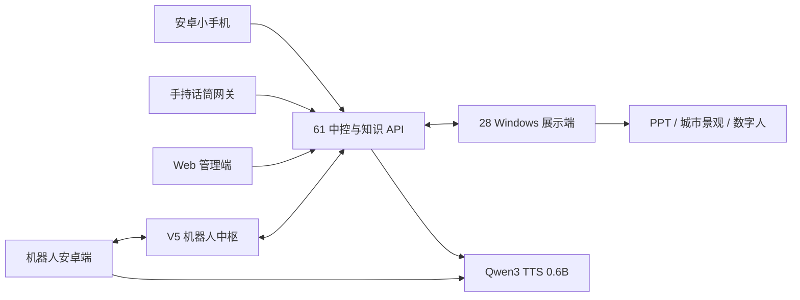

# 智能展厅讲解系统

统一管理知识和媒体，通过手机、手持话筒、机器人接收提问，向指定屏幕或机器人提供回答、语音及展示控制。

这是 **2026-09-11 当前源码维护备份**，按职责整理六个工程，不导入各端旧提交历史。后续开发者从对应目录开始。

| 工程 | 职责与需求入口 |
| --- | --- |
| [platform/central](platform/central) | 61 主机中控、API、知识与媒体管理、Web 管理端、音色及打断 |
| [apps/display-windows](apps/display-windows) | 28 主机 Windows 客户端，PPT、屏幕播放、城市景观切换 |
| [apps/phone-android](apps/phone-android) | 安卓小手机，按住说话、松手发送、按下打断、屏号选择 |
| [services/voice-gateway](services/voice-gateway) | 手持话筒语音网关 v0.3.8，采音、唤醒、离线识别 |
| [apps/robot-android](apps/robot-android) | 机器人安卓客户端，语音交互、播放和机身设置 |
| [services/robot-hub](services/robot-hub) | 机器人 V5 中枢，接入、教学流程、问答转发 |

先读 [架构与开发指南](docs/DEVELOPMENT.md)，再读各工程 README/HANDOFF。来源、验证及未包含项见 [交付状态](docs/HANDOFF-STATUS.md)。原交接材料中的本机路径、旧独立仓库规划和上传命令仅作历史参考，以本仓库根文档为准。



## 获取代码

```bash
git lfs install
git clone http://192.168.18.233:8090/lianzong/smart-guide-20260910.git
```

只取源码时可设置环境变量 `GIT_LFS_SKIP_SMUDGE=1` 后 clone；需要安装包再执行 `git lfs pull`。现有安装包在 [release-assets](release-assets/README.md)，与源码分开、用 Git LFS 管理。

61、28 是原现场主机简称，**28 主机对应 target=2，不是 target=28**。新现场重新配置地址、屏号、凭据和知识内容。

真实密钥、数据库、日志、客户素材和本机 SDK 路径不提交。源码备份不等于一键恢复完整现场；外部软件和模型需另行准备。本次上传不部署或重启生产服务。
